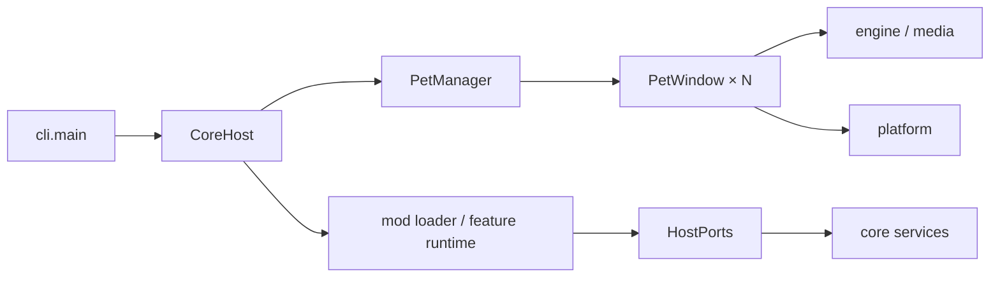

# petcore · dsh-pet-indesktop

基于 Python + PySide6 的桌面宠物核心，按 **core + mod** 拆分窗口交互、动画、内容、平台能力和业务扩展。
本 README 面向 `feat/petcore-vpet-architecture` 分支的开发者，状态更新于 **2026-11-09**。
当前 Core 版本为 **0.5.0**；版本号不代表本分支所有平台都已有对应正式安装包。

运行入口是 `python -m petcore`。旧 `pet/` 与 `python -m pet` 保留作迁移参照及部分媒体适配，
两者的配置结构、窗口拓扑和发布产物不能混用。旧版用户文档可从 Git 历史查看。

- [架构与边界](#架构与边界)
- [近期改动](#近期改动)
- [Linux 与 macOS 适配](#linux-与-macos-适配)
- [开发环境与运行](#开发环境与运行)
- [扩展开发](#扩展开发)
- [测试与验证](#测试与验证)
- [候选构建](#候选构建)
- [文档导航](#文档导航)

## 架构与边界

petcore 使用**单进程、多宠独立窗口**：`CoreHost` 装配共享服务，`PetManager` 管理宠物窗口，
`PetWindow` 负责交互与绘制。Linux/macOS 实现在 `petcore/platform/`，不引入旧版 overlay
或跨进程碰撞架构。多屏位置使用 Qt 逻辑坐标，DPR 只参与图像及原生像素边界转换。



| 路径 | 职责与约束 |
| --- | --- |
| `petcore/engine/`、`contracts/` | 动画、几何、状态及端口契约；不依赖 Qt，contracts 只依赖标准库 |
| `petcore/media/`、`content/` | WebP 帧序列 / WebM / GIF、角色内容；仅 media 和 `content/legacy.py` 可直接适配 `pet.*` |
| `petcore/platform/` | 平台能力、输入区域、原生窗口策略、屏幕、自启与权限诊断 |
| `petcore/ui/` | Qt 窗口、气泡、菜单、设置和端口装配；Qt 对象在其所属线程操作 |
| `petcore/mods/`、`builtin/` | 包发现、校验、安装与贡献注册；内置 feature 与可安装扩展分开 |
| `petcore/net/`、`api/`、`account/` | 网络出口、服务规格、系统钥匙串和账户能力；mod 通过端口访问 |
| `examples/petcore-mods/` | 可安装 feature 样板，包括 AI 对话、Agent、OCR、音乐、天气、提醒与 QQ 桥接 |

核心菜单必须登记设置落点；新增持久设置须遵守保存/取消和配置作用域契约。
角色定位与贴边按 `body_box`，输入命中与绘制共用缩放、镜像、旋转、Q 弹和偏移变换。
API Key 只进入系统钥匙串；`api.json` 保存服务规格。feature mod 当前为 host-only，
**没有沙箱或热卸载隔离保证**。详细约束以 [petcore/AGENTS.md](petcore/AGENTS.md) 为准。

## 近期改动

以下是本分支 11 月以来的实现摘要；不同功能和平台的验证范围分别记在对应报告中。

| 批次 | 主要变化 | 记录 |
| --- | --- | --- |
| 11-01～11-02：对话、记忆与语音 | 对话视图与 `chat_view` 扩展接缝、数据/缓存根搬迁、记忆管理与召回、外部记忆只读融合、分句朗读与预合成 | [L151–L162 索引](docs/PETCORE-LOG-INDEX.md) |
| 11-03：台词与 AI 回复 | 每日台词与自定义台词组成循环播放池；点击台词可恢复内置；提示词上限可见化；误输出工具调用时兜底；本地/data 图片与可选 GIF 表情回复 | [台词记录](docs/PETCORE-LOG.md#l164--2026-11-03--每日播放池循环--点击台词初始句--人设卡扩容与重写)、[AI 回复报告](docs/PR-REPORT-AI-TOOLS-PROMPT-MEME-2026-11-03.md) |
| 11-03～11-04：启动与界面 | 首帧后分步加载扩展、点击反馈不受音效阻塞；修复快速对话深色模式黑底；补充角色扮演人设卡 | [启动与点击](docs/PR-REPORT-CLICK-PACKS-STARTUP-2026-11-03.md)、[对话与人设](docs/PR-REPORT-QUICKCHAT-PERSONAS-2026-11-04.md) |
| 11-05：QQ 与数据健壮性 | 修复设置页凭据接线，验证 token 持久化；兼容 OneBot 鉴权形式；加固数据根、扩展替换与会话坏时间戳处理 | [QQ 桥接报告](docs/PR-REPORT-QQ-BRIDGE-AND-UPSTREAM-AUDIT-2026-11-05.md) |
| 11-07～11-08：Linux/macOS | 平台能力矩阵、输入与窗口策略、自启、候选构建；在 VM 中定位并修复输入法/系统库混载、GIF 命中、Cocoa 托盘、字体布局和权限诊断问题 | [Linux/POSIX 报告](docs/PR-REPORT-PETCORE-POSIX-2026-11-07.md)、[Mac 报告](docs/PR-REPORT-PETCORE-MACOS-2026-11-08.md) |

与旧版 v4.3–v4.4 的功能归属和差距见 [功能对照](docs/PETCORE-V43-V44-PARITY-2026-11-05.md)。
该文档是 11-05 快照，其中“非 Windows 平台层”的后续进展以本页和 POSIX 报告为准。

## Linux 与 macOS 适配

### 目标与已有证据

| 平台 | 实现目标 | 已验证 | 尚未交付或验证 |
| --- | --- | --- | --- |
| Linux x86_64 | Ubuntu 22.04+；X11，以及 Wayland 会话中的 XWayland/xcb | Ubuntu 22.04 构建/ELF 审计；Ubuntu 24.04.5 GNOME Wayland + xcb 的源码与候选包交互、中文输入、安装升级、真实重登自启 | Ubuntu 22.04 真实桌面、独立 Xorg 桌面、KDE、Hyprland、多屏/热插拔；没有发布正式 Release |
| macOS | macOS 14.4+；arm64 `.app` 为构建目标，Intel 保留源码运行 | Intel macOS 15.8.2 / Qt 6.12.0 VM 的原生交互、中文输入、菜单/设置/聊天、全屏转场、截图、人工穿透恢复、真实重登自启 | 当前 VM 为 x86_64，尚无 arm64 `.app` / 签名 / 安装验收；独立桌面 Space 切换、双 Retina、混合缩放和热插拔未验 |
| Windows | 保留现有实现与专有平台能力 | 原有路径与本次跨平台回归分开记录 | 当前整仓及压力测试仍有未通过项，见下方验证记录 |

### Linux 实现

- **启动与能力**：创建 `QApplication` 前选择 xcb，尊重显式 `QT_QPA_PLATFORM`；缺少
  XWayland/xcb 或误用原生 Wayland 时给出诊断。界面与 `--check` 共用能力矩阵。
- **输入与贴边**：XFixes ShapeInput 使用当前可见 alpha 轮廓，缓存静态区域、保留拖动连续性，
  隐藏/关闭释放，句柄重建后重放。逻辑位置与原生视口分离，避免 GNOME 限制透明画布出屏。
  XFixes 失败会明确降级为矩形输入，不改用 Linux 全局光标轮询。
- **桌面恢复与自启**：无系统托盘时提供任务栏恢复窗口；自启写用户级 XDG `.desktop`，
  保留解释器、工作目录、数据根和实例参数，覆盖中文与空格路径。
- **冻结包**：Ubuntu 22.04 / glibc 2.35 基线，PySide6 6.11.3；构建匹配 Qt 的 Fcitx 插件，
  审计 ELF 架构/依赖/glibc，隔离宿主 Qt/GIO 插件。文件选择器使用随包 Qt，避免 GTK/IBus ABI 混载。
  部分内置按钮仍为英文，宿主 GVfs 远程卷扩展不在当前冻结包支持范围。

### macOS 实现

- **窗口策略**：桌宠使用普通无边框 NSWindow；桌宠、气泡与灵动岛被动显示不抢焦点，
  设置/聊天/截图选择层仍可主动激活并输入。原生属性在显示与句柄重建后重放。
- **透明输入与菜单**：更新现有 NSWindow 的 `ignoresMouseEvents`，不逐帧切换 flags/show；
  菜单栏状态图标使用共用 QMenu 会话，动作在菜单关闭后执行，支持右键鼠标通路。
- **截图与恢复**：采集前检查录屏权限，拒绝时不先隐藏宠物或返回黑图；修复截图层的
  Spaces 策略。用户已手动验证托盘开启/关闭穿透及恢复点击；CGEventPost 自动化异常另行保留。
- **自启与资源**：用户级 LaunchAgent 保留源码/冻结启动参数；`.app` 资源与用户数据分离。
  arm64 构建入口包含 bundle 配置、ad-hoc 签名与签名检查，但当前 Intel VM 未执行成功构建。
- **原生测试发现的共用修复**：GIF 帧统一为 QImage 供 alpha 命中；修正 CJK 字体回退下的
  气泡高度、窄设置窗布局，以及跨时区缓存时间比较。

两端手动穿透均为**整窗穿透**，通过托盘或恢复窗口关闭。Windows 专有的全局快捷键、
GPU/FPS、系统麦克风和 SMTC 本轮未移植，配置值保留，界面/诊断明确可用性。
历史 issue/PR 与本分支的对应处理见 [POSIX 历史缺陷表](docs/PETCORE-POSIX.md#历史缺陷对应)，
不能把上游 PR 的方案或合并状态当作本分支的实测结果。

## 开发环境与运行

以下命令在仓库根目录执行。跨平台验收使用 **Python 3.12**；POSIX 依赖约束见
[`packaging/petcore-posix-constraints.txt`](packaging/petcore-posix-constraints.txt)，
其中 Linux 为 PySide6 6.11.3，macOS 为 6.12.0。

Windows / PowerShell：

```powershell
py -3.12 -m venv .venv
.\.venv\Scripts\python.exe -m pip install -r requirements.txt
.\.venv\Scripts\python.exe -m petcore --check --strict
.\.venv\Scripts\python.exe -m petcore --root .scratch/dev-data --character shenshen
```

Linux / macOS：

```bash
python3.12 -m venv .venv
.venv/bin/python -m pip install -r requirements.txt -c packaging/petcore-posix-constraints.txt
.venv/bin/python -m petcore --check --strict
.venv/bin/python -m petcore --root .scratch/dev-data --character shenshen
# Linux：在 Wayland 桌面中显式使用 XWayland
QT_QPA_PLATFORM=xcb .venv/bin/python -m petcore --root .scratch/dev-data
```

`--check --strict` 做资源与诊断检查，不创建桌宠窗口；它不能替代桌面输入或安装验收。
Linux 系统依赖、输入法匹配与诊断方法见 [POSIX 运行说明](docs/PETCORE-POSIX.md#运行与自启)。
`--instance <name>` 创建独立数据根/锁的应用实例，不用于实现进程内多宠。

默认数据目录：Windows `%APPDATA%/dsh-pet-core`；Linux
`$XDG_CONFIG_HOME/dsh-pet-core`（默认 `~/.config/dsh-pet-core`）；macOS
`~/Library/Application Support/dsh-pet-core`。开发和回归优先显式 `--root`，与日常数据隔离。
POSIX 自启入口为 `python -m petcore --root <data-root> autostart on|off|status`，
只注册用户级条目；LaunchAgent 在下次登录生效。

## 扩展开发

Core 内置 feature 位于 `petcore/builtin/features/`，可安装样板位于
[`examples/petcore-mods/`](examples/petcore-mods/README.md)。功能包通过 `HostPorts`
使用展示、调度、存储、HTTP、API、语音等服务，不直接 import core 的具体业务实现。

```bash
# 在已激活的虚拟环境中执行；所有命令使用同一个独立数据根
python -m petcore --root .scratch/dev-data mods validate examples/petcore-mods/ai.chat
python -m petcore --root .scratch/dev-data mods install examples/petcore-mods/ai.chat
python -m petcore --root .scratch/dev-data --allow-feature-mods
```

feature 包需安装到用户数据根的 `mods/` 并获准执行；仅传 `--mods-dir` 不会绕过授权。
角色 content 包与 feature 包的加载规则不同。扩展字段、菜单/设置贡献及生命周期见
[开发指南](docs/PETCORE-MOD-DEVELOPMENT.md)与[格式契约](docs/PETCORE-MOD-FORMAT.md)。

## 测试与验证

先运行改动相关回归，再按 [AGENTS.md](AGENTS.md) 的风险门决定整仓与时序压力验证。
无头用 `offscreen`；原生 xcb/Cocoa 结果单独记录。以下为激活虚拟环境后的 Bash 示例：

```bash
python -m ruff check pet/ tests/ petcore/
QT_QPA_PLATFORM=offscreen python -m pytest -q tests/test_petcore_*.py
QT_QPA_PLATFORM=offscreen python -m pytest -q
# Linux：真实 X 服务端输入检查，不等同桌面合成器验收
QT_QPA_PLATFORM=xcb xvfb-run -a python -m pytest -q tests/test_petcore_native_desktop.py
# macOS：在 Cocoa 桌面会话中执行
QT_QPA_PLATFORM=cocoa python -m pytest -q tests/test_petcore_native_desktop.py
```

截至 2026-11-08 的证据如下，**不是对后续提交自动有效的全绿声明**：

| 证据 | 结果与范围 |
| --- | --- |
| Linux 累计回归 | 3620 passed / 18 skipped；Ubuntu GNOME 的候选安装、中文输入、文件选择、托盘恢复、自启及资源只读复核已做 |
| Mac 累计回归 | 两条命令合计 3639 passed / 19 skipped；包含 petcore 与公共守卫，不是整个旧版仓库的 Mac 全量 |
| Mac 时序压力 | 4 vCPU 满载三轮，每轮 127 passed / 1 skipped |
| Windows 最终整仓 | 11760 passed / 24 skipped / 7 failed；七项与既有基线相同；另有布局族在压力下 Qt 原生退出超时，未解决 |
| 短性能 | Linux、Mac 各完成单/四宠 × 待机/动画/拖动/隐藏 × 3 组，每组至少 60 秒；原始口径与 CPU/RSS/线程/输入计数见各报告 |
| 长期与硬件限制 | 30 分钟内存观察已取消；未验证长期增长、物理热插拔、混合缩放多屏；Mac arm64 候选尚未交付 |

Linux 性能使用进程组口径，Mac 的 CPU 只统计应用主进程、子进程 RSS 单列；不能直接据此
做跨平台性能排名。Mac 的 24 组有效样本来自 18+6 两次进程，首轮中止记录保留。
完整失败清单、命令、环境、摘要和实测数据见 [Linux 报告](docs/PR-REPORT-PETCORE-POSIX-2026-11-07.md)
及 [Mac 报告](docs/PR-REPORT-PETCORE-MACOS-2026-11-08.md)。

## 候选构建

本分支候选与旧 `dsh-pet-standalone-*` 发布线分开。以下是构建入口，不表示产物已正式发布。

| 平台 | 入口 | 产物与约束 |
| --- | --- | --- |
| Windows | `scripts/build_petcore.ps1` | onedir + 可选 Inno Setup；11-05 曾构建 0.5.0 开发证书签名 setup，该历史包不含后续全部 POSIX 修改 |
| Linux | `scripts/build_petcore_linux.sh` | Ubuntu 22.04 x86_64 原生构建，输出 `dsh-pet-core-linux-x86_64.tar.gz`；第六轮候选已验，未上传正式 Release |
| macOS | `scripts/build_petcore_macos.sh` | 要求原生 arm64、macOS 14.4+；目标 `dsh-pet-core-macos-arm64.app.zip`；当前 Intel VM 被架构门正确拒绝 |

```bash
# POSIX：先按 workflow 安装系统编译/运行依赖，使用全新的输出目录
.venv/bin/python -m pip install PyInstaller -c packaging/petcore-posix-constraints.txt
PYTHON_BIN="$PWD/.venv/bin/python" bash scripts/build_petcore_linux.sh --output .scratch/linux-candidate-1
# 在 Apple Silicon 构建机上执行
PYTHON_BIN="$PWD/.venv/bin/python" bash scripts/build_petcore_macos.sh --output .scratch/macos-candidate-1
```

构建会运行 `--check --strict`，产生 `check.json`、`native-audit.json`、`build.json` 和
`source-files.json`。Linux 检查随包 ELF、Fcitx 来源和动态依赖；macOS 构建入口执行
ad-hoc 签名与严格签名检查，不能把 ad-hoc 当成 Developer ID 公证。
只读 bundle 资源、用户数据与可导入扩展分离，Windows 专属二进制不进入 POSIX 包。

[`petcore-posix-candidate.yml`](.github/workflows/petcore-posix-candidate.yml) 手动触发三端验证
和候选 artifacts，只有仓库只读权限，不自动发布 Release；旧发布流程保留。
完整依赖与安装入口见 [POSIX 构建说明](docs/PETCORE-POSIX.md#候选构建)。

## 文档导航

| 文档 | 用途 |
| --- | --- |
| [文档索引](docs/INDEX.md) | 查找现行契约、历史快照与交付报告 |
| [工程约定](AGENTS.md)、[petcore 约定](petcore/AGENTS.md) | 修改前必读；线程、分层、设置、测试和交付纪律 |
| [petcore 开发者上手](petcore/README.md) | 目录、CLI、菜单项、mod 与角色包开发 |
| [最终规格](docs/PETCORE-SPEC.md)、[架构](docs/PETCORE-ARCHITECTURE.md)、[路线图](docs/PETCORE-ROADMAP.md) | 契约、分层及计划；实现状态须对照日志 |
| [POSIX 桌面说明](docs/PETCORE-POSIX.md) | 平台接缝、历史缺陷映射、构建和原生验收 |
| [扩展开发](docs/PETCORE-MOD-DEVELOPMENT.md)、[mod 格式](docs/PETCORE-MOD-FORMAT.md)、[角色包](docs/PETCORE-CHARACTER-PACKS.md) | 扩展作者的接线与数据契约 |
| [变更日志索引](docs/PETCORE-LOG-INDEX.md) | 先查批次，再读对应 LNNN，避免把旧快照当作当前结论 |

每批 petcore 改动追加日志及索引；行为变更交付逐文件说明、实测性能和原生运行证据。
许可与素材归属见 [LICENSE](LICENSE) 和 [THIRD_PARTY_NOTICES.md](THIRD_PARTY_NOTICES.md)。
