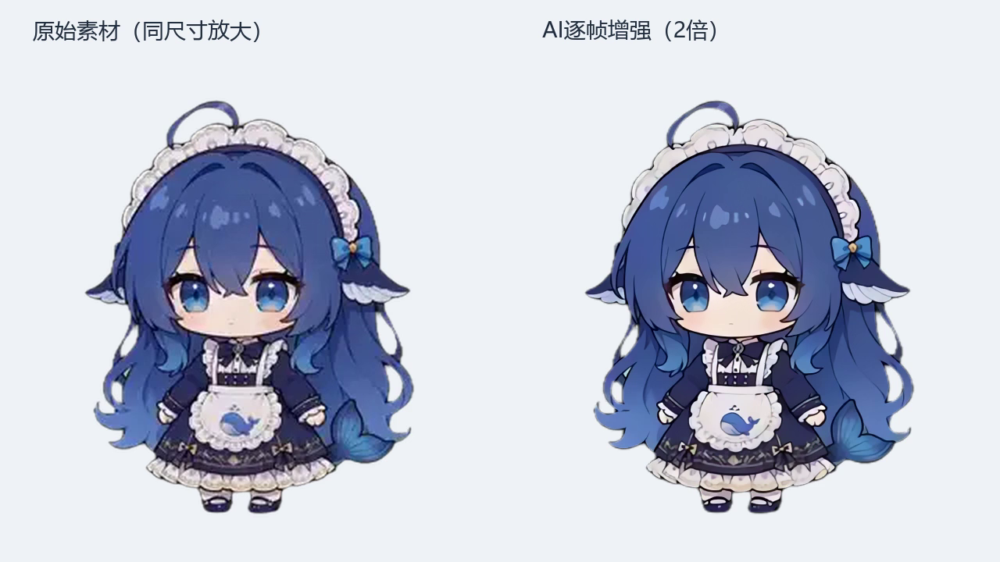

# 可选离线 AI 动画增强（实验工具）

**基线：2026-10-24 / v4.4.0 主线；工具独立于运行时。**
这是给素材制作者的离线实验入口，把现有帧序列做 2 倍 AI 超分辨率增强。
AI 会估计细节，不等于获得原生高清母版；不保证逐帧完全无闪烁，需要人工看完整动画。
原生高分辨率素材优先，AI 增强只是可选方案。



图中角色 OC「溟月」来自画师上善无形；动画素材来自
[PC2005-cloud/dsh-pet](https://github.com/PC2005-cloud/dsh-pet)，由本项目整理。
仅用于非商业效果比较，继续遵循 [第三方素材声明](../THIRD_PARTY_NOTICES.md#2-character-animation-assets深深--小鲸鱼-webm-素材)。
图中的基线是 v4.3.4 的 Q70/v5 帧，不是当前主线无损/v6 素材；不能把图里的全部收益归因于超分辨率。

## 边界

- 不新增桌宠设置，不在运行时加载 PyTorch/DirectML，不改变默认依赖。
- 不读配置、凭据、聊天记录，不联网下载模型，不停止或重启桌宠。
- 输入与输出目录不能相同、互相包含；已有未知输出不会被覆盖。
- 输出 `encoder` 明确标记 AI 增强，**不冒充**当前 `ENCODER_DESC` 的位精确素材。
- 这是独立审阅树，**不能直接替换** `assets/characters/*/frameseq` 或注册到 `packs-index.json`。
  现有发布流程见 [PACK-PUBLISHING.md](PACK-PUBLISHING.md)；如何为 AI 派生素材定义新的
  pipeline 身份和正式发布门，留给维护者后续单独评估。本工具不放宽任何现有闸门。

## 环境与模型

建议 Windows 11、Python 3.12、独立虚拟环境；本次仅实测 DirectML + NVIDIA RTX 4050。
不要在桌宠运行环境里同时安装两种 ONNX Runtime wheel，它们共享 `onnxruntime` 模块。

```powershell
python -m venv .venv-ai
.venv-ai\Scripts\python -m pip install -r tools/requirements-ai-upscale.txt
```

在另一个 CPU PyTorch 环境安装 `torch>=2.6` 和 `onnx>=1.17`，从
[Real-ESRGAN 官方发布页](https://github.com/xinntao/Real-ESRGAN/releases/tag/v0.2.5.0)
下载 `realesr-animevideov3.pth`，然后显式导出模型：

```powershell
python tools/export_ai_upscale_model.py --weights realesr-animevideov3.pth --output dist-ai-upscale/animevideov3-x2.onnx
```

导出器核对官方 checkpoint SHA-256
`b8a8376811077954d82ca3fcf476f1ac3da3e8a68a4f4d71363008000a18b75d`，
以 `weights_only=True` 加载，不覆盖已有输出。
网络来源、BSD-3-Clause 许可见 [第三方声明第10节](../THIRD_PARTY_NOTICES.md#10-可选离线-ai-增强工具)。
输出为动态 batch 的 uint8 NCHW RGB → uint8 NCHW RGB 2 倍 ONNX 模型。
网络仍是官方 SRVGG animevideov3；将 4 倍输出缩至 2 倍的 cubic（a=-0.75）
表达为等价分组卷积，避免 DirectML 不支持的 cubic Resize 落到 CPU。

## 导出与恢复

`--source` 可指定一个含 `meta.json` 的片段，也可指定完整帧序列根目录。
先预览，不加载推理引擎、不创建输出目录：

```powershell
python tools/ai_upscale_frameseq.py --source INPUT --output OUTPUT --dry-run
```

实际运行：

```powershell
.venv-ai\Scripts\python tools/ai_upscale_frameseq.py --source INPUT --output OUTPUT --model dist-ai-upscale/animevideov3-x2.onnx --provider dml --device 0 --batch 4
```

多显卡机器的 adapter 编号可能不同；显存不足时先降低 `--batch`。
缺少指定 provider 时明确失败，不把 DirectML 请求静默替换为 CPU。
CPU 入口用于兼容/诊断，尚未测量其完整动画性能。

每段完整写入临时目录，确认帧数后才发布。失败/中断不会发布半段，临时目录留待诊断。
再次执行时只复用完整片段；源帧摘要、模型摘要、时长信息或已输出文件变化都会拒绝跳过。
中断片段重新导出，已完成片段不重做。工具不自动清理未知输出或旧临时目录。

每段保留原 FPS、帧数和序号；RGB 由模型增强，alpha 独立做 bicubic 2 倍缩放。
结果为无损 WebP，透明像素的 RGB 也保留；源文件不写回。
模型精度、编码耗时、体积和播放负担都需要按目标设备实测。

## 验证与限制

实机结果、命令、测试及与本地原型的口径区别见
[PR 实测报告](PR-REPORT-OFFLINE-AI-UPSCALE-2026-10-24.md)。
本 PR 不包含模型二进制、完整动画包、用户目录或配置；只附一张已署名的效果对比图。
默认播放器、素材位精确验证、下载器和分发索引保持不变。
