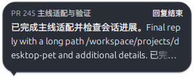

# Codex 联动与结构化进展气泡

基线：`34d810b1eadd98d00e7cb9b3b51428a45b5bf03e`（v4.4.0）；分支：`feat/pr245-v440-port`；日期：2026-10-27。
本报告只记录该功能的实现与验证，随对应功能提交交付。

## 核心特性

菜单安装/关闭 Codex 插件；hook 提供会话生命周期与权限状态，文件通知增量读取公开进展与最终回复。
气泡分开显示会话标题、当前操作和正文，支持截断、淡化、缩放和按回合去重；未实际展示的正文不记为已交付。
功能沿用现有 Agent 模块激活规则；关闭时不启动监视器，启用时保持 Qt 对象归属与 worker 停止规则。
配置迁移保留旧自定义通道数据。相关约定见 [Agent 联动协议](AGENT_LINK_PROTOCOL.md)。

## 修改文件说明

逐文件增删按 `git diff 34d810b1eadd98d00e7cb9b3b51428a45b5bf03e <本功能提交> --numstat` 统计：

| 文件 | 增/删行 | 修改与原因 |
|---|---:|---|
| `docs/INDEX.md` | +2/−0 | 登记该功能交付报告，提供功能维护入口。 |
| `docs/PR-REPORT-CODEX-LINK-2026-10-27.md` | +95/−0 | 记录本功能的逐文件说明、性能与真实环境验证。 |
| `docs/screenshots/codex-link/bubble-dark-x11.png` | 二进制，19198 字节 | 保存三行最终回复与截断淡化效果，支持深色呈现验收。 |
| `docs/screenshots/codex-link/bubble-x11.png` | 二进制，18814 字节 | 保存 Qt 6.11.2 原生 X11 下两行进展气泡，支持布局验收。 |
| `integrations/dsh-pet-codex/.codex-plugin/plugin.json` | +17/−0 | 声明本地 Codex 插件身份与版本。 |
| `integrations/dsh-pet-codex/hooks/hooks.json` | +100/−0 | 声明 Codex 生命周期与权限 hook。 |
| `integrations/dsh-pet-codex/scripts/bridge.py` | +215/−0 | 把生命周期 hook 写入有界快照并保留会话身份。 |
| `integrations/dsh-pet-codex/scripts/diagnostics.py` | +105/−0 | 限制 hook 执行时间，记录脱敏诊断。 |
| `packaging/pet_entry.py` | +5/−1 | 在导入 GUI 前分流 hook，保留卸载、设置和 OCR 入口。 |
| `packaging/pet_entry_no_chat.py` | +4/−0 | 在导入 GUI 前分流 hook，保留卸载、设置和 OCR 入口。 |
| `pet/__main__.py` | +7/−0 | 在导入 GUI 前分流 hook，保留卸载、设置和 OCR 入口。 |
| `pet/agent_bubble_content.py` | +67/−0 | 按字体度量绘制标题、状态、截断正文和淡化末行。 |
| `pet/agent_file_watch.py` | +80/−0 | Qt 文件通知唤醒后台读取，不引入周期轮询。 |
| `pet/agent_link/__init__.py` | +322/−16 | 接入快照监视器、插件安装和气泡去重；按父包导入适配主线目录结构。 |
| `pet/agent_snapshot.py` | +139/−0 | 聚合会话快照，限制记录数量与有效期。 |
| `pet/codex_install.py` | +254/−0 | 安装插件到稳定运行目录，避免缓存路径失效。 |
| `pet/codex_transcript.py` | +251/−0 | 增量读取公开会话内容，忽略未知消息。 |
| `pet/config.py` | +40/−3 | 增加默认关闭的 Codex 配置，迁移旧自定义通道以保留用户数据。 |
| `pet/context_menus/shared.py` | +7/−0 | 增加 Codex 安装/关闭菜单与处理中反馈。 |
| `pet/features.py` | +4/−2 | 把 Codex 配置与名称纳入现有 Agent 模块的激活和搜索规则。 |
| `pet/hook_runtime.py` | +55/−0 | 提供无 GUI hook 入口，失败仍返回成功。 |
| `pet/multi_window_shared.py` | +19/−3 | 透传结构化气泡参数与实际交付结果，避免被抑制的进展记为已展示。 |
| `pet/overlay_shell.py` | +6/−2 | 保留歌词 reserve 语义，透传结构化气泡字段。 |
| `pet/speech_bubble.py` | +55/−4 | 加入结构化内容并适配主线重排，修复状态气泡缩放。 |
| `pet/sprite_bubble.py` | +8/−3 | 透传结构化内容，按实际窗口坐标定位气泡。 |
| `pet/window.py` | +5/−2 | 保留主线优先级和交付返回值，补充结构化参数。 |
| `pet/window_optional_services.py` | +1/−1 | 将 Codex 纳入可选服务启用判断。 |
| `scripts/benchmark_codex_link.py` | +53/−0 | 测量快照读取、hook 子进程和 Python 堆增长。 |
| `tests/codex_helpers.py` | +19/−0 | 共享临时 hook 与 Qt 事件等待夹具。 |
| `tests/test_agent_link.py` | +1/−0 | 登记默认关闭的 Codex 配置。 |
| `tests/test_codex_bubble.py` | +149/−0 | 覆盖标题/状态分离、截断、行距、去重、交付失败、状态缩放与实际窗口锚点。 |
| `tests/test_codex_file_watch.py` | +136/−0 | 覆盖文件创建/替换重订阅、增量通知、停止与销毁后 worker 退出。 |
| `tests/test_codex_hook_runtime.py` | +141/−0 | 验证坏 JSON、脚本丢失、超时和日志写入失败均不阻断 hook。 |
| `tests/test_codex_install.py` | +40/−0 | 验证本地插件安装、关闭和稳定运行目录，保护既有配置。 |
| `tests/test_codex_transcript.py` | +270/−0 | 覆盖生命周期快照、多会话、JSONL 增量读取、最终回复与旧配置迁移。 |
| `tests/test_desktop_pet_features.py` | +13/−1 | 允许实际 Codex 集成和本次报告使用其名称，继续禁止无关产品文案借用品牌。 |
| `tests/test_feature_modules_gating.py` | +13/−3 | 验证 Codex 开关与模块激活组合，不构造停用服务，停止后释放 watcher。 |

## 性能分析

命令：`.venv/bin/python scripts/benchmark_codex_link.py`；环境：Linux x86_64、Python 3.11.16、PySide6 6.11.2。
16 活跃会话，2000 次未变化读取、另 2000 次 Python 堆采样、30 次 hook 子进程：

```text
16 active sessions unchanged poll, n=2000, us median/p95 95.16 98.9
additional 2000 polls traced retained/peak bytes 192 7792
hook subprocess n=30 ms median/p95 23.73 35.6
snapshot bytes 6141
```

以上读取是基准循环，不是运行期轮询。关闭时无文件 watcher/读取 worker；启用后新增一个读取线程，
由文件通知和会话到期时间唤醒，40ms 合并通知。hook 每次创建子进程、锁定并写有界快照和诊断文件；
运行期无新增网络请求，插件安装通过 Codex CLI 执行。气泡进展最多每 0.5 秒更新一次，正文去重缓存有上限。
内存数字只覆盖 Python 堆，不据此推断 Qt 原生分配或整个进程的长期 RSS。

## 实机运行记录

Qt 6.11.2 下此前实际运行过默认源码入口与 `main(enable_chat=False)` 各 15 秒，隔离配置、缓存与网络，均无 Traceback；
本轮联动/气泡实现与该验证时相同，未安装插件到用户客户端或改变信任配置。
原生 X11 截图已检查：标题与状态分离、正文两行/最终三行、尾部截断淡化，位于图示边框内。




坏 JSON、缺脚本、超时和诊断写入失败由真实 hook 子进程回归覆盖，返回成功空响应；不阻断客户端会话。

## 测试与验证

- 2026-10-27 归并前的功能提交独立复跑 Codex/气泡/配置与功能门控相关文件：132 passed、2 skipped（35.80 秒）。
- 2026-10-28 范围复核：撤回通用 `_fire_done` 配置检查及相应 DSH/G2 夹具改动。Codex 快照取消旧完成定时器，结束时直接展示最终回复，不依赖通用完成推断。
- 本轮仅撤回无关修复并更新报告；当前联合回归结果见 [X11 报告](PR-REPORT-X11-DESKTOP-2026-10-27.md)，完整分支门禁和安装包验收仍待单独执行。

## 边界与回滚

Windows/macOS 原生桌面、混合 DPI 与非矩形布局仍未实机验证。源码运行终止检查使用 SIGTERM，未算作托盘正常退出验收。
可撤回对应功能提交；卸载联动插件时保留用户会话文件。主线依赖与构建策略保持不变。
